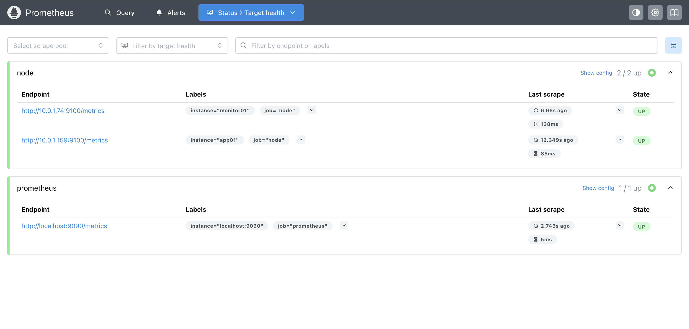
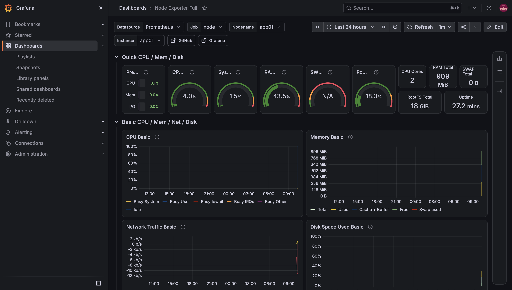
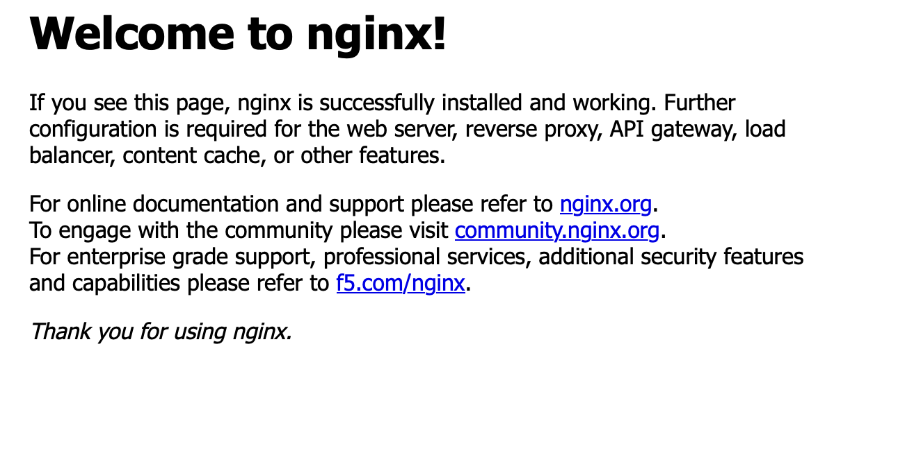
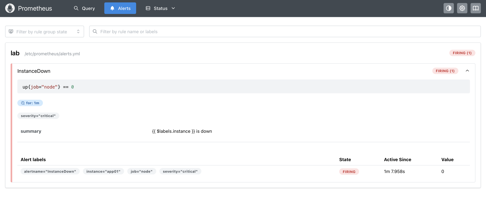

# AWS Infrastructure Migration


Cloud version of my [Linux Infrastructure Automation Lab](https://github.com/jineshptl/linux-infrastructure-automation-lab). Same two servers, now on AWS with Terraform and Ansible.

Architecture: [docs/architecture.md](docs/architecture.md)

## Requirements

Check these on your local machine first:

```bash
aws --version
terraform --version
ansible --version
ls ~/.ssh/id_ed25519.pub
```

- AWS CLI: `brew install awscli`
- Terraform and Ansible: see [setup in the on-prem lab](https://github.com/jineshptl/linux-infrastructure-automation-lab#4-automation-tools-macos)
- SSH key: if missing, create one as in [SSH key login](https://github.com/jineshptl/linux-infrastructure-automation-lab#8-ssh-key-login) (only the `ssh-keygen` command)

## Setup

```bash
git clone https://github.com/jineshptl/aws-infrastructure-migration.git
cd aws-infrastructure-migration
```

## AWS login

Use an IAM user with MFA, not root.

```bash
aws login
aws sts get-caller-identity
```

## Cost alert

Set this up before creating anything. Servers cost about $1/day while running.

Billing and Cost Management → Budgets → Create budget → **Monthly cost budget** template, `$10`, your email.

Verify the email AWS sends, otherwise no alerts are sent.

## VPC

VPC, public subnet, internet gateway and route table. Config: [terraform/vpc.tf](terraform/vpc.tf)

```bash
cd terraform
terraform init
terraform plan
terraform apply
```

## Security groups

SSH and web ports open to your IP only. Config: [terraform/security.tf](terraform/security.tf)

```bash
echo "admin_cidr = \"$(curl -s https://checkip.amazonaws.com)/32\"" > terraform.tfvars
terraform apply
```

If your IP changes, run both commands again.

## IAM role

Lets the servers use SSM and CloudWatch without storing access keys. Config: [terraform/iam.tf](terraform/iam.tf)

```bash
terraform apply
```

## EC2

app01 (t3.micro) and monitor01 (t3.small), Ubuntu 24.04. Config: [terraform/ec2.tf](terraform/ec2.tf)

```bash
terraform apply
ssh ubuntu@$(terraform output -raw app01_ip)
```

## Tear down and start again

Destroy everything when you're done to stop paying:

```bash
cd terraform
terraform destroy
```

To start again later:

```bash
aws login
echo "admin_cidr = \"$(curl -s https://checkip.amazonaws.com)/32\"" > terraform.tfvars
terraform apply
terraform output
```

Servers get new IPs every time.

## Ansible inventory

Ansible finds the servers by their AWS tags, so no IPs are hardcoded. Config: [ansible/inventory/aws_ec2.yml](ansible/inventory/aws_ec2.yml)

```bash
cd ansible
unset AWS_ACCESS_KEY_ID AWS_SECRET_ACCESS_KEY AWS_SESSION_TOKEN AWS_CREDENTIAL_EXPIRATION
eval "$(aws configure export-credentials --format env)"
ansible-inventory --graph
ansible all -m ping
```

The `eval` line passes your `aws login` session to Ansible. Run it again in each new terminal.

## Server setup and Docker

Same playbooks as the on-prem lab. No `-K` needed on AWS. Playbooks: [ansible/playbooks](ansible/playbooks)

```bash
cd ansible
ansible-playbook playbooks/setup.yml
ansible-playbook playbooks/docker.yml
```

## Nginx

Runs in Docker on app01, port 8080. Playbook: [ansible/playbooks/nginx.yml](ansible/playbooks/nginx.yml)

```bash
cd ansible
ansible-playbook playbooks/nginx.yml
curl http://$(cd ../terraform && terraform output -raw app01_ip):8080
```

## Prometheus and Grafana

Node Exporter on both servers, Prometheus and Grafana in Docker on monitor01. The Prometheus config is built from the inventory ([template](ansible/playbooks/templates/prometheus.yml.j2)). Files: [monitoring/](monitoring/), [ansible/playbooks/monitoring.yml](ansible/playbooks/monitoring.yml)

```bash
cd ansible
ansible-playbook playbooks/node_exporter.yml
ansible-playbook playbooks/monitoring.yml
```

- Prometheus: `http://<monitor01_ip>:9090/targets`
- Grafana: `http://<monitor01_ip>:3000` (admin / admin first login), import dashboard `1860`

## Screenshots

| | |
|---|---|
|  |  |
|  |  |

## Rebuild from scratch

```bash
aws login
unset AWS_ACCESS_KEY_ID AWS_SECRET_ACCESS_KEY AWS_SESSION_TOKEN AWS_CREDENTIAL_EXPIRATION
eval "$(aws configure export-credentials --format env)"

cd terraform
echo "admin_cidr = \"$(curl -s https://checkip.amazonaws.com)/32\"" > terraform.tfvars
terraform apply
sleep 60

cd ../ansible
ansible-playbook playbooks/setup.yml
ansible-playbook playbooks/docker.yml
ansible-playbook playbooks/nginx.yml
ansible-playbook playbooks/node_exporter.yml
ansible-playbook playbooks/monitoring.yml
```

Takes about 10 minutes. Tear down with `terraform destroy` when done.

## Failure tests

Broke things on purpose, then found and fixed them. Notes in [confluence/](confluence/).

- [Nginx down](confluence/nginx-down.md)
- [Security group rule removed](confluence/security-group-broken.md)
- [Node Exporter down](confluence/node-exporter-down.md)



## CI

Every push and PR runs: terraform fmt and validate (both stacks), ansible-lint (both projects), shellcheck on `scripts/`, and a gitleaks secret scan over the full history. Main only changes if all pass. Workflow: [.github/workflows/ci.yml](.github/workflows/ci.yml)

## Kubernetes

2-node Kubernetes cluster (kubeadm, v1.35) on AWS, built the CKA way. Terraform makes the servers, Ansible prepares them, `kubeadm init` and `join` by hand. Steps: [kubernetes/README.md](kubernetes/README.md)

## Cost check

One command to see if anything in AWS is still costing money, in every region: servers, disks, Elastic IPs, NAT gateways, load balancers, databases, S3. Script: [scripts/aws-check.sh](scripts/aws-check.sh)

    aws login
    ./scripts/aws-check.sh

Prints `ALL CLEAR` or lists what's still running. If the login has expired, it says so instead of saying all clear. Run it after every `terraform destroy`.
