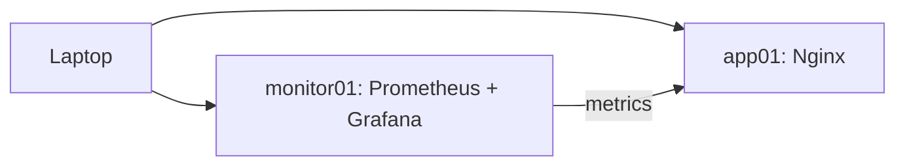
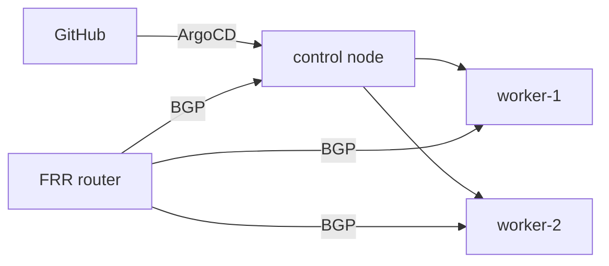

# Architecture

## 2-server lab

Two servers on AWS. Terraform builds them, Ansible sets them up. Only my IP can reach them.

## Kubernetes lab

One control node, two workers and a router. Cilium runs the network. BGP sends the app IP (`10.200.0.0`) to the router, so if one worker dies the other one keeps the site up.

ArgoCD deploys whatever is in Git. I reach the servers through SSM, not SSH.
